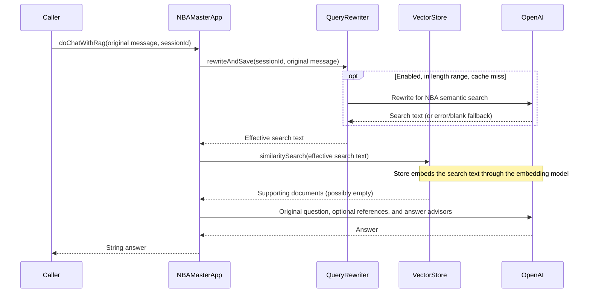

# Agent behavior and workflows

Return to [Readme.md](Readme.md). This document describes the application's NBA assistant and the workflow for maintaining it.

## What the NBA agent does

`NBAMasterApp` uses a system prompt asking for clear, concise, evidence-based NBA reasoning about games, players, teams, trades, signings, and historical series, with appropriate uncertainty. It is a synchronous chat/RAG component. There is no planner, external tool registry, autonomous execution loop, web search, or live NBA statistics integration.

The application uses a Spring AI `ChatClient` backed by an OpenAI API `ChatModel`. The separate direct SDK demo is not the application's orchestration layer. [Configuration](docs/configuration.md#models-and-effective-configuration) explains how to select the model explicitly through the checked-in examples rather than relying on library defaults.

## Calling the agent

Inject `NBAMasterApp` into another Spring component. The following are Java API examples, not HTTP routes:

```java
String answer = nbaMasterApp.doChat(
        "What makes a good supporting cast around a ball-dominant star?", sessionId);

NBAMasterApp.TeamTradeEvaluation evaluation = nbaMasterApp.doChatWithTeamTradeAnalysis(
        "Analyze the 2021 Westbrook trade from the Lakers perspective.", sessionId);

String groundedAnswer = nbaMasterApp.doChatWithRag(
        "Why was the Lakers' 2021 Westbrook trade a poor fit?", sessionId);
```

Use a unique, nonblank conversation ID for each conversation, and reuse it for follow-ups. All three methods share the same memory repository and conversation namespace. A caller must decide how to associate IDs with users; the repository itself provides no access control.

| Method | Output | Additional behavior |
| --- | --- | --- |
| `doChat(message, sessionId)` | `String` | Answer using NBA system prompt and conversation memory |
| `doChatWithTeamTradeAnalysis(message, sessionId)` | `TeamTradeEvaluation` | Adds a record-specific system instruction and converts the response with `.entity(...)`; no retrieval |
| `doChatWithRag(message, sessionId)` | `String` | Rewrites the retrieval query, searches the selected vector store, augments the original question, logs request/response |

The application methods call `.call()`, so they do not expose a streaming API. `MyLoggerAdvisor` supporting `StreamAdvisor` does not change that.

## Basic chat and memory

The answer client's default advisors include `ReReadingAdvisor` and `MessageChatMemoryAdvisor`. Rereading transforms the current user text into the question followed by `Read the question again: <question>`. The memory advisor uses `ChatMemory.CONVERSATION_ID` to load/store conversation messages through `MessageWindowChatMemory(maxMessages=10)`.

The window is ten messages, not ten user/assistant turns; system-message handling is managed by Spring AI. Do not assume the persisted text is the raw user input: advisors modify prompts along the chain. Advisors run according to their Spring AI order values, not solely the order of `.advisors(...)` calls; both custom advisors default to order 0.

`FileBasedChatMemoryRepository` stores a replaced `ArrayList<Message>` in one Kryo file per conversation. The filename is the unpadded URL-safe Base64 encoding of the UTF-8 ID plus `.kryo`; `NBAMasterApp` chooses the persistence directory relative to the process working directory. Missing conversations return an empty list; writes replace existing contents. Repository instances can reload files written by prior instances.

There is no scheduled deletion, TTL, file locking, versioned serialization format, or atomic write. A `ThreadLocal<Kryo>` avoids sharing a serializer across threads, but does not serialize concurrent writes to a conversation. Retain the directory to preserve chats across restarts, and coordinate access before using concurrent requests or multiple processes against the same files.

## Structured trade evaluation

`doChatWithTeamTradeAnalysis` returns this nested record:

| Field | Java type | Intended meaning |
| --- | --- | --- |
| `teamName` | `String` | Team whose perspective is being evaluated |
| `assetsReceived` | `List<String>` | Incoming players, picks, or other assets |
| `assetsSent` | `List<String>` | Outgoing assets |
| `shortTermImpact` | `String` | Immediate basketball/rotation effects |
| `longTermImpact` | `String` | Timeline and roster-building effects |
| `basketballFit` | `String` | Fit with the team's existing core |
| `capOrContractImpact` | `String` | Salary, contract, and flexibility implications |
| `mainRisks` | `List<String>` | Main uncertainties and downside |
| `teamGrade` | `String` | Team-specific evaluation grade |

This contract uses Spring AI response conversion. The code does not configure provider-native strict JSON schema output, validate the returned field values, or enforce a grade enum. Conversion or model errors can propagate. The trade-evaluation Markdown file supplies richer RAG guidance, but it is not automatically retrieved by this structured method. There is currently no combined structured-plus-RAG public method.

## RAG request workflow



The rewritten text replaces only the query used by `VectorStoreDocumentRetriever`. `RetrievalAugmentationAdvisor` augments the original answer question with retrieved documents. Retrieval uses a `SyncTaskExecutor` rather than allocating a thread pool per request. It requests the top four results with no metadata filter and uses `app.rag.retrieval.similarity-threshold` (default 0.5) to reject weak matches. The cutoff is a heuristic that needs calibration with the embedding model and corpus.

Query rewriting uses the same configured chat model through a separate client with no answer memory/rereading advisors. Its caches are in memory. It preserves names, dates, constraints, and language by prompt instruction; that instruction is not a factual correctness guarantee. It does not resolve ambiguous follow-up references from conversation history. A rewrite failure falls back to the original input; an embedding, store, or final answer error has no equivalent application fallback.

Inspect the latest effective search text in Java with `queryRewriter.getLastRewrittenQuery(sessionId)`. This includes original text when rewriting was skipped or failed. It is diagnostic session state, not the conversation transcript. See [query rewriting](docs/query-rewriting.md) for cache and validation behavior.

NBA scope and evidence policy live in the shared system prompt for basic, structured, and RAG chat. Unrelated requests should be politely declined in the requested response format. Retrieved frameworks and historical examples support basketball reasoning rather than define the assistant's entire knowledge. Current rosters, injuries, scores, and recent transactions require verification through suitable tools when available; without current evidence, the model should state the limitation and qualify any assumptions. The application has no such tools wired yet, and the prompt forbids claiming tool use or verification that did not occur.

The customized contextual augmenter treats matching documents as optional reference material. Empty context is allowed and preserves the original question instead of replacing it with a refusal. The similarity cutoff filters references; it does not determine NBA scope or answerability. Retrieval is still attempted on every `doChatWithRag` call. These are prompt instructions, so factual correctness and model compliance are not guaranteed. The return type remains `String`; there is no status/JSON contract, explicit source-citation response contract, or automated freshness check. Service failures still propagate separately.

## Ingestion workflow and model usage

Ingestion is separate from answering: scan classpath Markdown, token-split parsed sections, generate five metadata keywords per chunk, then embed/store chunks. It is controlled by `app.rag.ingestion.enabled` and runs on startup, not through an upload endpoint. Simple mode rebuilds once per enabled startup. PGVector skips matching source hashes/pipeline versions and transactionally replaces changed files together with their registry records. See [RAG](docs/rag.md) for the document lifecycle.

Basic and structured chat perform an answer-model call per request. A RAG request may also call the rewrite model on a cache miss and the embedding API for search. Startup can make corpus embedding calls, and enriched ingestion adds keyword-generation calls. Exact request counts depend on parsing, batching, retries, and caches. Disabling rewriting or optional ingestion does not make the whole application offline.

`NBAMasterApp` logs answer content at INFO, and RAG additionally installs `MyLoggerAdvisor` to log request/response text. Treat logs, conversation files, and hosted vector contents as user/document data when deciding retention and access.

## Maintainer workflow

1. Read [Architecture.md](Architecture.md) to identify the owner of a behavior. Keep application prompts/orchestration in `NBAMasterApp`, rewrite behavior in `QueryRewriter`, parsing in the document loader, and storage construction in the two configuration classes.
2. When changing a prompt or output contract, verify both text and structured paths. If changing `TeamTradeEvaluation`, update the record, system instruction, structured tests, corpus output mapping/examples, and this guide together.
3. When changing corpus files, follow [RAG authoring and ingestion](docs/rag.md#changing-the-corpus). Code blocks and blockquotes are separate parsed documents and may be retrieved after splitting.
4. When changing embeddings, check the 1536-dimension pgvector builder and rebuild affected vectors. Matching dimensions alone does not make embeddings from different models comparable.
5. Run the relevant [isolated tests](docs/testing.md#isolated-unit-tests). Run full-context/live tests only with deliberate model/database configuration; their startup can call services or write vectors.
6. Update the linked documents and perform the [second-pass documentation checks](docs/testing.md#second-pass-documentation-review). Base repository references on tracked files, and use the POM rather than `dep_tree.txt` for dependency versions.
