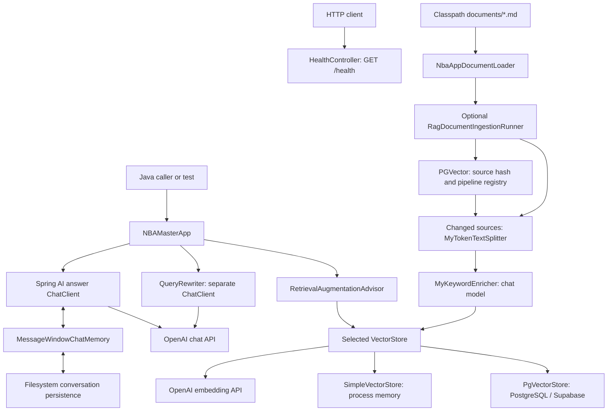

# Architecture and repository map

Return to [Readme.md](Readme.md). For behavioral details, read [Agent.md](Agent.md); for operational configuration, read [docs/configuration.md](docs/configuration.md).

## System boundary

This is one Maven module, with a single Spring Boot application under `com.peter.nbagamemaster`. Packages organize responsibilities; they are not separately deployed services. `NBAMasterApp` composes Spring AI advisors around one injected `ChatModel`. `QueryRewriter` builds a separate client using the same model bean. Both clients therefore share model configuration, while only the answer client has conversation memory and rereading advisors.

The pinned Spring AI OpenAI integration uses the Chat Completions API by default (`/v1/chat/completions`), while the standalone `SDKAiInvoke` demo uses the Responses API. Embeddings use the separate embedding API. The SDK dependency does not mean the main application uses the SDK demo's client or model setting.

`SimpleVectorStore` and `PgVectorStore` are alternatives. The diagram's retrieval path applies to `doChatWithRag`; basic and structured chat do not retrieve documents. Retrieval and model calls are synchronous in the application API. There are no application tool calls, NBA data feeds, autonomous planning loops, or background agents.

## Startup and dependency wiring

1. `NbaGameMasterApplication` starts Spring Boot and scans the application package.
2. Spring AI auto-configures OpenAI chat/embedding models from `spring.ai.openai.*`. Spring Boot's JDBC starter also triggers data source auto-configuration unless explicitly excluded.
3. Exactly one vector-store factory should match `app.vector-store.type`:
   - Missing or `simple`: bean `vectorStore`, initially empty; ingestion populates it if enabled.
   - `pgvector`: bean `pgVectorVectorStore`, which initializes the database schema through Spring's bean lifecycle; it does not load documents by itself.
   - Any other value: neither factory matches, so required vector-store injection fails.
4. `NBAMasterApp` constructs its filesystem memory repository and answer client. Its `@Resource` field is named `nbaAppVectorStore`, but neither factory uses that name; injection relies on the single matching `VectorStore` type. Adding multiple stores requires explicit wiring changes.
5. If `app.rag.ingestion.enabled=true`, `RagDocumentIngestionRunner` parses, token-splits, enriches, and stores the corpus after context initialization. Simple mode rebuilds once. PGVector checks the persistent registry first and replaces only new/changed files or outdated pipeline versions, committing each source's vectors and registration together.

The pgvector factory returns the `VectorStore` interface, but the concrete instance implements Spring initialization. Its configured schema initialization is performed when managed as a Spring bean. Building a store manually outside Spring does not itself run that lifecycle callback.

## Repository-level files and directories

| Path | Purpose |
| --- | --- |
| `pom.xml` | Single-module dependency/build definition: Java 17, Spring Boot 3.5.13, Spring AI BOM 1.1.5, compilation/packaging plugins |
| `mvnw`, `mvnw.cmd` | Unix/Windows Maven wrapper launchers |
| `.mvn/wrapper/maven-wrapper.properties` | Wrapper 3.3.4 configuration selecting Maven 3.9.14; downloads a distribution when needed |
| `.gitignore` | Excludes local credentials/configuration, generated output, runtime state, and IDE metadata |
| `.gitattributes` | Git text/line-ending handling |
| `dep_tree.txt` | Historical dependency-tree output; contains Spring AI 1.1.4, so it is not authoritative for the current build |
| `Readme.md`, `Architecture.md`, `Agent.md` | Documentation entry point, structural map, and agent/workflow guide |
| `docs/configuration.md` | Setup, properties, models, Supabase/JDBC, troubleshooting |
| `docs/rag.md`, `docs/query-rewriting.md` | Corpus/ingestion/retrieval guide and rewrite internals |
| `docs/sql/rag_document_ingestion.sql` | Fresh-database registry schema with RLS enabled |
| `docs/testing.md` | Test classification, commands, limitations, and documentation verification |
| `docs/examples/application-simple.yml` | Credential-free example that selects in-memory vectors and excludes JDBC auto-configuration |
| `docs/examples/application-pgvector.yml` | Credential-free JDBC/pgvector example with explicit OpenAI models |

## Production Java files

All paths below are relative to `src/main/java/com/peter/nbagamemaster/`.

| File | Responsibility |
| --- | --- |
| `NbaGameMasterApplication.java` | Spring Boot `main` entry point and component scan root |
| `controller/HealthController.java` | `GET /health` returning the literal string `ok`; no dependency probes |
| `app/NBAMasterApp.java` | NBA system prompt; basic chat; structured `TeamTradeEvaluation` record; RAG chat; ten-message persisted memory; per-request conversation ID |
| `advisor/ReReadingAdvisor.java` | Repeats the user's question with `Read the question again:` before forwarding; customizable template/order, default order 0 |
| `advisor/MyLoggerAdvisor.java` | Logs request/response text at INFO; implements synchronous and streaming advisor interfaces, order 0 |
| `advisor/package-info.java` | Package-wide Spring non-null annotations |
| `chatMemory/FileBasedChatMemoryRepository.java` | Spring AI `ChatMemoryRepository` implementation with Kryo serialization, URL-safe Base64 conversation filenames, list/read/replace/delete operations |
| `rag/NbaAppDocumentLoader.java` | Snapshots/hashes `classpath:documents/*.md`, parses selected sources, attaches filename/source key metadata; read errors propagate |
| `rag/NbaAppVectoreStoreConfig.java` | Default/simple store factory; builds an empty store. `Vectore` is the current filename/class spelling |
| `rag/PgVectorVectorStoreConfig.java` | Manual JDBC pgvector factory; 1536 dimensions, cosine distance, HNSW index, `public.vector_store`, schema initialization, batch limit 10000 |
| `rag/RagDocumentIngestionRunner.java` | Conditional startup ingestion: dispatch persistent ingestion or populate the simple store once |
| `rag/MyTokenTextSplitter.java` | Default and customized token splitting; ingestion uses the 200-token target configuration |
| `rag/RagDocumentIngestionRepository.java` | JDBC access to the five-column successful-ingestion registry |
| `rag/PgVectorDocumentIngestion.java` | Skip matching registrations; split/enrich changed sources; assign stable chunk IDs; transactionally replace vectors and registry |
| `rag/MyKeywordEnricher.java` | Uses the injected chat model and Spring AI `KeywordMetadataEnricher` to request five keywords per document |
| `rag/QueryRewriter.java` | NBA search-query transformer; length gates, bounded synchronized LRU maps for successful rewrites/latest session searches, graceful model-error fallback |
| `demo/invoke/SDKAiInvoke.java` | Standalone OpenAI Java SDK Responses API example; explicitly selects `gpt-4.1-nano-2025-04-14`, prints the first text output |
| `demo/invoke/TestApiKey.java` | Resolves the standalone SDK demo's API key; supports environment and JVM property configuration |
| `demo/invoke/SpringAiInvoke.java` | Starts the complete application context without a web server, obtains a bare `ChatClient.Builder`, and calls a sample prompt; startup store/ingestion work still applies |
| `demo/invoke/SpringAiInvoke2.java` | Commented-out `CommandLineRunner` example; no active component/class |
| `demo/invoke/LangChain4jInvoke.java` | Entirely commented-out alternative integration; LangChain4j dependency is also commented out in the POM |

`spring-ai-advisors-vector-store` is declared, but the implemented RAG path uses `RetrievalAugmentationAdvisor` from `spring-ai-rag`. The pgvector starter is commented out; the active manual factory uses `spring-ai-pgvector-store`, JDBC, and the PostgreSQL driver. Changing `spring.ai.vectorstore.pgvector.*` does not reconfigure this factory's hard-coded builder values.

## Knowledge corpus

The five Markdown resources are data sent through the embedding/RAG pipeline, not repository developer documentation. Each file's role is listed in [docs/rag.md](docs/rag.md#bundled-corpus). Files in root or `docs/` are outside the loader's resource pattern and are not ingested.

## Tests

All paths below are relative to `src/test/java/com/peter/nbagamemaster/`.

| File | Purpose and dependency boundary |
| --- | --- |
| `NbaGameMasterApplicationTests.java` | Full Spring context smoke test; startup can invoke model/database services |
| `app/unit/NBAMasterAppUnitTest.java` | Mocked chat/rewriter/store tests for basic text, record conversion, and retrieval of the rewritten query while answering the original question; writes local memory files |
| `app/NBAMasterAppTest.java` | Full-context live chat/memory, trade-analysis, and RAG tests; gated by JVM property `nba.e2e.enabled=true`, tagged `e2e` |
| `advisor/ReReadingAdvisorTest.java` | Verifies question augmentation and preservation of the system message without a Spring context |
| `advisor/MyLoggerAdvisorTest.java` | Verifies synchronous logging/returned response; streaming-related test inspects private logging helpers rather than running the full streaming chain |
| `chatMemory/FileBasedChatMemoryRepositoryTest.java` | Temporary-directory persistence across repository instances and conversation deletion |
| `rag/QueryRewriterTest.java` | Mocked rewrite, prompt preservation, caching/LRU, fallback/retry, validation, and bounded session storage tests |
| `rag/NbaAppDocumentLoaderTest.java` | Isolated source discovery, SHA-256, snapshots, parser metadata/segmentation, and read-failure tests |
| `rag/MyTokenTextSplitterTest.java` | Real tokenizer coverage for chunk size, content preservation, metadata, and empty/short inputs |
| `rag/PgVectorDocumentIngestionTest.java` | Mocked skip/reindex, stable IDs, transaction boundaries, rollback, and retry tests |
| `rag/RagDocumentIngestionRepositoryTest.java` | JDBC row mapping and five-column success-upsert contract |
| `rag/RagDocumentIngestionRunnerTest.java` | Simple split/enrich/store order, empty corpus, and persistent dispatch without duplicate writes |
| `rag/PgVectorVectorStoreConfigTest.java` | Full-context similarity-search smoke test (`topK=2`); logs results with no assertions and does not force pgvector selection |

See [testing](docs/testing.md) before choosing a command: class names alone do not indicate whether a test is isolated from external services.

## Persistence and limitations

| State | Location/lifetime | Current caveats |
| --- | --- | --- |
| Conversation messages | Filesystem persistence configured in `NBAMasterApp`; survives restart if retained | Local files, no TTL, no file locking/atomic replacement, no application-level encryption or cross-instance coordination |
| Rewrite cache/latest session searches | Process memory; evicted by capacity or restart | Exact input keys, shared rewrite cache across sessions, no follow-up resolution using history |
| Simple document vectors | Process memory | Rebuilt on enabled ingestion startups; empty if ingestion disabled; no save/load |
| pgvector document vectors | PostgreSQL `public.vector_store` | Changed sources replace old chunks; missing local files are retained; no concurrent ingestion coordination |
| Successful source ingestions | PostgreSQL `public.rag_document_ingestion` | Source SHA-256, explicit pipeline version, chunk count, completion time; schema provisioned separately |

There is no application authentication, authorization, or mapping of conversation IDs to users. Structured output is a Java conversion contract without additional domain validation. Model/retrieval failures beyond rewriting generally propagate. These are implementation boundaries to account for before adding an HTTP chat API or deploying multiple instances.
