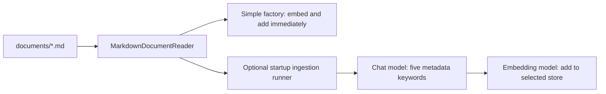

# RAG knowledge base and document lifecycle

Return to [Readme.md](../Readme.md). The answer workflow is in [Agent.md](../Agent.md#rag-request-workflow); configuration is in [configuration.md](configuration.md).

## Bundled corpus

The loader reads only `classpath:documents/*.md`, corresponding to `src/main/resources/documents/` in this project. It does not crawl nested directories, root documentation, `docs/`, web pages, or arbitrary local files.

| Resource | Knowledge supplied |
| --- | --- |
| [trade-evaluation-framework.md](../src/main/resources/documents/trade-evaluation-framework.md) | General trade-analysis dimensions, team perspective, risks, grade guidance, and structured output mapping |
| [westbrook-to-lakers-2021.md](../src/main/resources/documents/westbrook-to-lakers-2021.md) | Historical Lakers/Westbrook case study: assets, fit, spacing, depth, contracts, and example evaluation |
| [star-fit-vs-star-talent.md](../src/main/resources/documents/star-fit-vs-star-talent.md) | Individual talent versus complementary skills, roster construction, and playoff fit |
| [non-shooting-guard-archetype.md](../src/main/resources/documents/non-shooting-guard-archetype.md) | Value/risks of non-shooting guards, lineup context, and playoff scalability |
| [contract-flexibility-in-trades.md](../src/main/resources/documents/contract-flexibility-in-trades.md) | Contract size/duration, flexibility, opportunity cost, and trade evaluation |

This is a small, curated analysis corpus, not a live or comprehensive NBA database. Its content is input to the model, not proof that generated answers are current or correct. The repository documentation review checks implementation and corpus organization; it is not an independent verification of every basketball claim in these files.

## Parsing contract

`NbaAppDocumentLoader.loadMarkdowns()` resolves matching resources, constructs a Spring AI `MarkdownDocumentReader` for each, and concatenates the reader results.

| Reader setting | Effect |
| --- | --- |
| `withHorizontalRuleCreateDocument(true)` | Horizontal rules can create document boundaries |
| `withIncludeCodeBlock(false)` | Fenced code examples are excluded from retrieved text |
| `withIncludeBlockquote(false)` | Blockquote content is excluded |
| `withAdditionalMetadata("filename", fileName)` | Parsed documents retain the source filename |

One file need not equal one Spring AI `Document`. There is no explicit token/text splitter, custom chunk-size policy, stable document ID assignment, or additional author/date metadata in the loader. The framework reader determines document segmentation under these settings.

The method catches `IOException` around resource resolution/the loop, logs the failure, and returns whatever documents have accumulated. It can therefore return an empty or partial corpus rather than fail startup. Other unchecked reader errors are not covered by that catch. No matching resources also yields an empty list. Resource ordering is not explicitly sorted.

Code-block examples such as the framework's Java record and the Westbrook JSON example are useful for humans but are intentionally outside embedded text. Important facts/instructions needed for retrieval should also appear in prose.

## Ingestion and storage behavior

| Store and runner setting | Startup result |
| --- | --- |
| Simple, ingestion disabled | Factory loads and embeds the corpus once into memory |
| Simple, ingestion enabled | Factory loads/embeds; runner loads again, enriches, and adds a second set |
| pgvector, ingestion disabled | Schema initialization occurs, but factory does not populate the corpus; existing database vectors remain available |
| pgvector, ingestion enabled | Runner loads, enriches, and embeds/adds the corpus to the database |

`MyKeywordEnricher` requests five keywords per parsed document using the injected chat model. Keywords are metadata, not a separately configured lexical index or reranker. The retrieval code does not explicitly filter on these keywords. Keyword generation adds model usage before embedding.

No ingestion manifest, deterministic IDs, content hashes, corpus version, delete-before-replace policy, or retry checkpoint is implemented. New parsing runs can produce new document IDs; repeated ingestion can accumulate duplicates and stale content. The runner logs the number added after `add` returns, but does not independently validate database contents. Do not enable it on every normal pgvector startup unless that behavior is intentional.

The runner does not catch keyword-generation or vector-store errors; they can fail startup. Conversely, the loader's caught I/O errors can supply an empty or partial corpus without making the runner fail. A successful startup/log message alone is therefore insufficient evidence of complete ingestion.

`SimpleVectorStore` is never saved to a local vector file by this application. pgvector writes to `public.vector_store`; its schema/index/dimension choices are documented in [configuration](configuration.md#postgresql-and-supabase).

## Retrieval contract

`NBAMasterApp.doChatWithRag` rewrites the user's input for vector search, creates a `VectorStoreDocumentRetriever`, and installs `RetrievalAugmentationAdvisor` for that request. See [query rewriting](query-rewriting.md) for the input gates, cache, and fallback contract.

With the pinned Spring AI 1.1.5 defaults, the retriever requests at most four documents with similarity threshold 0.0 and no metadata filter. The application does not override these defaults, add a reranker, or perform keyword/full-text search. `PgVectorVectorStoreConfigTest`'s explicit `topK(2)` is only a test search and does not change the application retriever.

The final model receives the original question with document context, subject to the answer client's other advisors. An empty result set leads to the framework's default cannot-answer instruction; the application does not opt into answering without context. A nonempty result is not a guarantee of relevance, accuracy, or citations. The application returns answer text without a separate list of source documents or a citation schema.

## Changing the corpus

1. Add/edit Markdown directly under `src/main/resources/documents/`. Keep facts, team perspective, dates, and uncertainty understandable in prose; avoid placing essential knowledge solely inside excluded blocks.
2. Inspect parsing output and `filename` metadata. The existing [loader test](../src/test/java/com/peter/nbagamemaster/rag/NbaAppDocumentLoaderTest.java) is only a smoke test with no assertions; it does not establish nonempty content, chunk count, or metadata correctness.
3. For simple mode, restart to rebuild vectors. Keep optional ingestion disabled if you want one initial corpus load.
4. For pgvector, plan how to replace affected/stale records before running enriched ingestion. There is no implemented synchronization command; do not assume restarting updates the stored corpus.
5. Keep the embedding model and dimension consistent for all stored documents and queries. The current database factory requires 1536 dimensions. Rebuild vectors when changing the model, and plan any required schema change separately.
6. Check retrieval with a focused question and inspect results, not only row counts or plausible answer text. Update the corpus table here when adding/removing files.

The application has no document upload API, background watcher, scheduled refresh, or administrative ingestion UI. Build/restart or deliberate startup ingestion is the current workflow.
