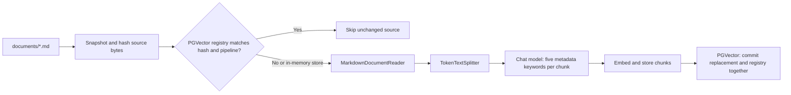

# RAG knowledge base and document lifecycle

Return to [Readme.md](../Readme.md). The answer workflow is in [Agent.md](../Agent.md#rag-request-workflow); configuration is in [configuration.md](configuration.md).

## Bundled corpus

The loader reads only `classpath:documents/*.md`, corresponding to `src/main/resources/documents/` in this project. It does not crawl nested directories, root documentation, `docs/`, web pages, or arbitrary local files.

| Resource | Knowledge supplied |
| --- | --- |
| [trade-evaluation-framework.md](../src/main/resources/documents/trade-evaluation-framework.md) | General trade-analysis dimensions, team perspective, risks, grade guidance, and structured output mapping |
| [westbrook-to-lakers-2021.md](../src/main/resources/documents/westbrook-to-lakers-2021.md) | Historical Lakers/Westbrook case study: assets, fit, spacing, depth, contracts, and example evaluation |
| [star-fit-vs-star-talent.md](../src/main/resources/documents/star-fit-vs-star-talent.md) | Individual talent versus complementary skills, roster construction, and playoff fit |
| [non-shooting-guard-archetype.md](../src/main/resources/documents/non-shooting-guard-archetype.md) | Value/risks of non-shooting guards, lineup context, and playoff scalability |
| [contract-flexibility-in-trades.md](../src/main/resources/documents/contract-flexibility-in-trades.md) | Contract size/duration, flexibility, opportunity cost, and trade evaluation |

This is a small, curated analysis corpus, not a live or comprehensive NBA database. Its content is input to the model, not proof that generated answers are current or correct. The repository documentation review checks implementation and corpus organization; it is not an independent verification of every basketball claim in these files.

## Parsing contract

`NbaAppDocumentLoader.discoverMarkdowns()` reads matching resources in filename order, computes SHA-256 over their exact bytes, and retains an in-memory snapshot. Parsing uses that same snapshot, so each hash describes exactly the bytes processed. The persistent ingestion path checks the registry before parsing. `loadMarkdowns()` remains available for loading the whole corpus.

| Reader setting | Effect |
| --- | --- |
| `withHorizontalRuleCreateDocument(true)` | Horizontal rules can create document boundaries |
| `withIncludeCodeBlock(false)` | Fenced code blocks are emitted as separate documents |
| `withIncludeBlockquote(false)` | Blockquotes start separate documents |
| `withAdditionalMetadata("filename", fileName)` | Parsed documents retain the source filename |
| `withAdditionalMetadata("source_key", source.sourceKey())` | Stable relative path, such as `documents/westbrook-to-lakers-2021.md` |

One file need not equal one Spring AI `Document`. After Markdown parsing, `MyTokenTextSplitter.splitCustomized()` uses the local `OverlappingTokenTextSplitter` to produce chunks of at most 200 CL100K_BASE tokens, including shared context. `app.rag.text-splitter.chunk-overlap` defaults to 40 tokens; set it to 0 to disable overlap. Valid values are 0 through 199. Each chunk after the first repeats up to the configured number of source tokens from the previous chunk and includes new content. Overlap resets for each parsed document, so it does not cross Markdown section or file boundaries.

The splitter prefers token-aligned punctuation boundaries beyond 100 characters when they preserve forward progress. UTF-8 character boundaries are preserved, so emoji and multilingual text are not cut into invalid characters. Whitespace trimming and character boundaries can reduce the shared context. Chunks of 10 characters or fewer are discarded. Splitting fails if more than 5000 windows are required, preventing an oversized final remainder from being embedded. Separators within chunks are preserved. These are splitting heuristics, not semantic guarantees. `splitDocuments()` still exposes Spring AI's unchanged defaults without overlap.

Resource discovery/read failures propagate instead of silently returning a partial corpus. No matching resources yields an empty list. Persistent ingestion rejects files that produce no embeddable chunks before deleting any existing vectors.

In the pinned Spring AI 1.1.5 reader, these flags separate code/quote content rather than discard it. Such documents also pass through token splitting and ingestion; fragments below the splitter's minimum length are discarded. Important facts/instructions should also appear in prose.

## Ingestion and storage behavior

| Store and runner setting | Startup result |
| --- | --- |
| Simple, ingestion disabled | Empty in-memory store; no corpus model calls |
| Simple, ingestion enabled | Runner parses, splits, enriches, and embeds the corpus once per startup; no database registry |
| pgvector, ingestion disabled | Schema initialization occurs, but factory does not populate the corpus; existing database vectors remain available |
| pgvector, ingestion enabled | Runner scans hashes, skips matching registrations, and replaces new/changed sources |

`MyKeywordEnricher` requests five keywords per split chunk using the injected chat model. Keywords are metadata, not a separately configured lexical index or reranker. The retrieval code does not explicitly filter on these keywords. Unchanged registered sources avoid both keyword and corpus embedding calls.

### Persistent registry and replacement

Provision the five-column `public.rag_document_ingestion` table using [the schema](sql/rag_document_ingestion.sql) for a fresh database. Existing tables created during setup need no schema changes. The application never creates or backfills the registry automatically. JDBC permissions must allow registry reads/writes; with RLS enabled, use an appropriate database role or explicit policies.

`RagDocumentIngestionRepository` reads the registry once per ingestion run. A source is skipped only when both its hash and pipeline version match. `app.rag.ingestion.pipeline-version` defaults to `token-v3`; bump it whenever parsing, overlap, other splitting settings, keyword settings, or the embedding model changes. Existing `legacy-v1` and non-overlapping `token-v2` registrations are deliberately reprocessed once to adopt overlap. If external configuration explicitly pins an older pipeline version, update it to `token-v3` as well. The model/dimension compatibility requirements still apply.

`PgVectorDocumentIngestion` parses, splits, and enriches each changed source before opening its write transaction. It assigns deterministic UUID chunk IDs derived from source key, hash, pipeline version, and file-wide chunk index. Source metadata and generated keywords are retained.

Using the same JDBC data source and transaction manager, it deletes vectors matching the source key or legacy filename, adds the replacement chunks, and upserts the registry row in one transaction. This also removes old duplicate rows for the affected filename. `PgVectorStore.add()` performs embedding inside that transaction; network latency can therefore extend the transaction. If embedding, vector insertion, or registry writing fails, database changes roll back, leaving the old vectors and registration available for retry. Parsing/enrichment failures happen before deletion. Errors propagate and can fail startup; earlier successful files stay committed and are skipped on retry.

This design assumes one ingestion instance at a time and one corpus in the configured vector table. There is no concurrent worker coordination, automatic removal of files deleted from the corpus, or detection of out-of-band database edits. Filenames alone cannot validate legacy contents; backfilled registrations are trusted. If vectors are manually deleted, remove their affected registry entries or bump the pipeline version before reingesting.

`SimpleVectorStore` is never saved to a local vector file by this application. pgvector writes to `public.vector_store`; its schema/index/dimension choices are documented in [configuration](configuration.md#postgresql-and-supabase).

## Retrieval contract

`NBAMasterApp.doChatWithRag` rewrites the user's input for vector search, creates a `VectorStoreDocumentRetriever`, and installs `RetrievalAugmentationAdvisor` for that request. See [query rewriting](query-rewriting.md) for the input gates, cache, and fallback contract.

With the pinned Spring AI 1.1.5 defaults, the retriever requests at most four documents with similarity threshold 0.0 and no metadata filter. The application does not override these defaults, add a reranker, or perform keyword/full-text search. `PgVectorVectorStoreConfigTest`'s explicit `topK(2)` is only a test search and does not change the application retriever.

The final model receives the original question with document context, subject to the answer client's other advisors. An empty result set leads to the framework's default cannot-answer instruction; the application does not opt into answering without context. A nonempty result is not a guarantee of relevance, accuracy, or citations. The application returns answer text without a separate list of source documents or a citation schema.

## Changing the corpus

1. Add/edit Markdown directly under `src/main/resources/documents/`. Keep facts, team perspective, dates, and uncertainty understandable in prose; code/quote blocks may be retrieved separately from surrounding explanations.
2. Inspect parsing output and source metadata. The isolated [loader test](../src/test/java/com/peter/nbagamemaster/rag/NbaAppDocumentLoaderTest.java) covers hashing, snapshots, metadata, code/quote segmentation, and read failures.
3. For simple mode, enable ingestion and restart to rebuild the in-memory vectors once.
4. For pgvector, enable ingestion and restart. New/modified files and outdated pipeline versions are replaced per source; unchanged registrations are skipped. Files missing locally are retained remotely until explicitly removed.
5. Keep the embedding model and dimension consistent for all stored documents and queries. The current database factory requires 1536 dimensions. Rebuild vectors when changing the model, and plan any required schema change separately.
6. Check retrieval with a focused question and inspect results, not only row counts or plausible answer text. Update the corpus table here when adding/removing files.

The application has no document upload API, background watcher, scheduled refresh, or administrative ingestion UI. Build/restart or deliberate startup ingestion is the current workflow.
